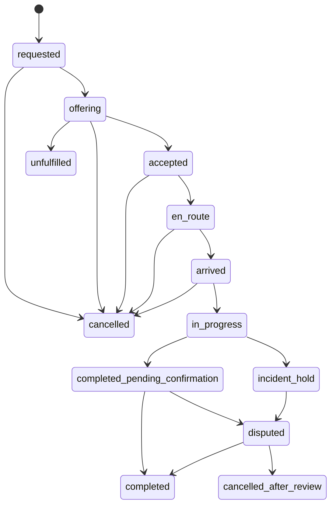

# Hela Service — Product Requirements & Technical Specification
**Version:** 1.0 (working baseline)  
**Date:** 4 November 2026  
**Status:** Proposed product design. No claim that PickMe's internal technology is known.  
**Owner:** Hela Service initiative, TRUST ecosystem

## 1. Executive decision
Build an independently engineered, Sinhala/Tamil/English, location-aware marketplace connecting Sri Lankan households with **category-verified** local service providers. The app uses the same **product patterns** as PickMe (request, discovery, offering, acceptance, tracking, support) but is adapted to high-trust in-home work. First launch is a controlled geography with a limited set of non-clinical categories.

### 1.1 Institutional separation
- **TRUST / mission institutions:** social purpose, community standards, social programs, oversight as appropriate to the eventual formal governance.
- **Commercial operator (proposed Sevana Innovations Pvt Ltd or other formally chosen operating entity):** paid service marketplace, software, provider/customer contracts, booking operations and commercial revenue.
- Keep bank accounts, ledgers, contracts, personal-data governance, grants/donations and brand/IP licensing separated through formal agreements where needed. Do not presume incorporation or final legal ownership.
- No cash distribution, loans, donations, CSR, NGOs/organizations as app users, or charitable aid operations in the commercial MVP.

### 1.2 Success definition
A household can request an eligible service, receive a transparent quote, be matched only with approved providers, confirm service delivery, report a problem and receive a traceable resolution. An administrator can explain **why** a provider was selected, access full status history and intervene safely.

## 2. Users and roles
| Role | Primary capabilities | Hard restrictions |
|---|---|---|
| Customer / family booker | Create account, manage addresses and authorized beneficiaries, request services, view offers, confirm completion, review/report | Cannot see unapproved providers or sensitive identity documents |
| Provider | Apply, submit required verification, publish availability after approval, accept offers, update service state, view earnings records | Cannot accept category not approved for; cannot alter own verification status |
| Admin | Review evidence, approve/deny by category, oversee booking/incident queue, facilitate reassignment | All verification decisions and overrides audited; cannot silently delete history |
| Super-admin | Policies, role grants, controlled category enablement, system configuration and access reviews | Privileged actions require stronger authentication and audit |

Accounts under legal adult age do not become providers. Beneficiaries can differ from bookers; collect their contact details only with an appropriate authorization and purpose. Support family members living outside Sri Lanka booking for authorized relatives in Sri Lanka.

## 3. Scope
### 3.1 P0 launch categories (proposed pilot subset)
- Errands and groceries (non-medical)
- Kitchen/laundry/household assistance
- House and pet sitting (only after property-access procedures are tested)
- General cleaning/household support
- Non-clinical elder companionship (additional safeguards; no medication administration or clinical care)

### 3.2 In catalog but **feature-gated** pending category-specific vetting and operating procedures
- Plumbing, electrical work, AC/appliance repair, gardening, drivers and handymen
- Tutoring/homework support
- Child supervision/childcare (do **not** enable without enhanced safeguarding, parental consent, escalation and legal review)

No clinical care, emergency response, medical diagnosis or regulated healthcare in the initial release.

### 3.3 P0 capabilities
- Mobile OTP onboarding, language selection and consent notices.
- Customer address capture with pin confirmation and address labels.
- Service catalog with requirements, duration, price basis and eligibility policy.
- Provider identity/reference/skill evidence submission, admin review, per-category approval and revocation.
- Provider service radius and schedule/availability.
- Request for immediate or scheduled services, ETA/quote preview, cancellation policy.
- Deterministic eligible-provider matching, time-limited offer acceptance, admin reassignment.
- Booking timeline, status notifications and proof of completion.
- Offline/cash-or-external settlement record; **not** an in-app wallet or payment collection.
- Ratings, complaints/incidents, audit trail, role-based dashboard and support contact.
- Sinhala/Tamil/English strings, accessibility, low-bandwidth support.

### 3.4 Explicitly out of scope
- Donations, volunteer/CSR/grant/education modules.
- In-app payment gateway, stored balance/wallet, lending and credit.
- Unverified automatic onboarding and unrestricted worker visibility.
- Continuous staff GPS surveillance or tracking inside a household.
- AI/ML-driven safety decisions or fully autonomous dispute outcomes.
- Guaranteed instant matching in regions where provider supply is insufficient.

## 4. PickMe-inspired functional mapping (external behavior only)
| Observed reference pattern | Hela Service adaptation | Design reason |
|---|---|---|
| Pickup and destination | Household location and service specification | A service task is not point-to-point transport |
| Vehicle type | Service category and required qualification | Skill and safeguarding eligibility |
| Available nearby driver | Available category-approved provider within service radius | Trust eligibility before proximity |
| Fare estimate | Fixed-price / hourly estimate / quote-required flow | Different task pricing structures |
| Booking for friend | Authorized booking for family member/beneficiary | Overseas family convenience |
| Driver ETA/tracking | Limited en-route ETA and explicit arrival/check-in | Avoid unjustified continuous tracking |
| Driver document onboarding | Provider identity, references, interviews and category-specific checks | Household-access risk |
| Trip receipt | Job completion record, payment status and commission ledger | Traceable accounting without gateway |
| Ride support/rating | Service dispute, safeguarding incident triage and ratings | Higher-risk in-home context |

Only reference features publicly documented by PickMe or independently observed with date/version in the evidence log. Do **not** claim Hela's API/service structure is PickMe's API/service structure.

## 5. End-to-end journeys
### 5.1 Customer booking
1. Login → language selection → manage address; booker specifies if booking for someone else.
2. Select service category, task details, requested time/duration and optional safe task photos.
3. Quote engine returns pricing method, indicative amount/range, travel charges if relevant, terms and possible service limitations.
4. Customer confirms request (idempotency key prevents duplicate bookings).
5. Matching service filters category-approved, non-suspended, available providers in range; sorts by travel estimate, capacity, fairness and reliability.
6. Issue one or more **controlled, time-limited offers** according to dispatch policy. Do not expose address/contact to providers before accepted/authorized stage.
7. Provider accepts → atomic reservation → booking status `accepted`; rejected/expired offers trigger next eligible provider.
8. Notify booker and, where authorized, beneficiary; limited ETA while provider travels.
9. Provider records `arrived`; beneficiary/booker confirms check-in with an expiring PIN or a staff-assisted exception.
10. Provider records `in_progress` and `completed`; customer confirms/flags issue. Record settlement **reported** then **confirmed** by second party/admin, with audit history.
11. Prompt review and permit complaint without public disclosure of identifying details.

### 5.2 Provider onboarding
`registered → verification_pending → under_review → approved_for_category` or `rejected / needs_more_info`; a provider can be approved in some categories and not others. Any `suspended`, `expired_credentials` or `revoked` category blocks matching. Document reason codes, effective/expiration dates and reviewer identity.

### 5.3 Admin intervention
An admin may cancel, offer reassignment, hold a disputed completion, suspend a provider or escalate a safeguarding case. All actions append an immutable event with actor, timestamp, reason code and case reference. Customers must have a visible support route. Emergency contact instructions must not suggest Hela replaces police/ambulance.

## 6. Booking state machine

State changes require authenticated roles, allowed transition, version check and append-only `booking_events`. Any reassignment must close the previous assignment and create a new one atomically.

### 6.1 Essential invariants
- A provider cannot receive an offer if any mandatory eligibility predicate is false.
- A provider cannot hold incompatible overlapping accepted assignments.
- Only one accepted assignment per booking at a time.
- An offer cannot be accepted after expiry, suspension, revocation, or a competing acceptance.
- A client retry must not create duplicate paid jobs or duplicate acceptance.
- Status history cannot be overwritten; admin overrides have reason and reviewer.
- No payment record claims funds collected by Hela unless a real collection occurred.

## 7. Matching algorithm — proposed independent implementation
### 7.1 Hard filter
For provider `p`, request `r`:
```
eligible(p,r) =
  active_account(p)
  AND approved_for_category(p, r.category)
  AND evidence_current(p, r.category)
  AND NOT suspended(p)
  AND covers_location(p, r.location)
  AND availability_covers(p, r.window)
  AND no_conflicting_booking(p, r.window)
  AND category_specific_safeguards_met(p, r)
```
Eligibility is a hard gate. No AI score, revenue optimization, review stars, or admin preference may override missing mandatory protections. Admins may **reassign among eligible** providers; exceptional policy overrides require separately approved procedure and must never bypass legal/safeguarding prohibitions.

### 7.2 Deterministic ranking
Normalize factors before combining:
```
score = 0.45 * normalized_travel_time
      + 0.25 * normalized_schedule_slack
      + 0.20 * normalized_recent_decline_or_cancellation_rate
      + 0.10 * normalized_allocation_fairness_penalty
```
Weights are **starting hypotheses, not measured or PickMe values**; tune using simulated cases and operational outcomes. Provider response probability may be considered later after bias and calibration review. Show a traceable explanation (`category approved; within 5-km radius; available; lowest combined score among eligible providers`). Do not infer sensitive traits.

### 7.3 Dispatch policy
- Start with a bounded sequence of offers to top eligible candidates; each offer has TTL and event IDs.
- Decide sequential vs carefully limited parallel offers based on simulations; first acceptance alone is insufficient without atomic database arbitration.
- If none accepts, return `unfulfilled` and human-support options; do not silently claim a confirmed booking.
- Keep `matching_decisions` logs: request ID, candidate count, exclusion reasons, ranked IDs, weights/config version, outcome.

## 8. Price, offline settlement and commission
Service category determines `fixed`, `hourly`, or `quote_required` method. A transparent example design:
```
estimate = base_fee + hourly_rate * estimated_hours + published_travel_fee
```
Customer sees whether the amount is fixed or only indicative. If quote-required, customer approves the final quote **before** dispatch/commencement. Price components, currency LKR, policy version, and revisions must be stored. Do not apply undisclosed dynamic pricing.

For offline payments maintain independent flags:
- `UNPAID`
- `CUSTOMER_REPORTED_PAID`
- `PROVIDER_CONFIRMED` (evidence of mutual acknowledgement, not evidence that the platform received funds)
- `DISPUTED`

Record commission as a separate **receivable/settlement obligation**, not as collected revenue by default. Financial recognition and tax treatment require an accountant's decision. Never blend commercial receipts with TRUST/CLG donations or grant accounting.

## 9. Privacy, security and safeguarding baseline
### 9.1 Security
- OTP throttling, fraud prevention and expiring sessions; administrators use MFA.
- Explicit RBAC/ABAC, object-level authorization on all reads/mutations, role-access tests.
- Encrypt transit/storage; segregate document storage; use pre-signed short-lived download grants.
- Store document-review metadata and restrict raw NIC/ID images to authorized reviewers.
- No exact household location in public listings or search results before suitable assignment.
- Redact PII/secrets in logs, record sensitive access, secure backups, dependency scans.
- Rate-limit booking, provider discovery and OTP; idempotency keys; replay prevention.
- Dedicated incident response and escalation queue; feature flag to disable category/region.
- Retention schedule and data subject inquiry/rights intake aligned with the laws in force at the relevant date.

### 9.2 Human safety
- Categories involving children/vulnerable adults disabled until explicit policy, training, vetting and human response capability exists.
- Separate identity confirmed, references checked, qualification checked and category-approved statuses; no unsupported 'background checked' badge.
- Explain who can enter a home, expected arrival window, household contacts, check-in and escalation.
- Provider emergency/offline support route, explicit no-entry and safe-exit policies.
- Support incident flags that trigger temporary offer suspension and human review, with procedural fairness.
- Location telemetry used only when needed for en-route ETA, not during in-home work by default.

### 9.3 Sri Lanka PDPA status as checked on 2026-11-04
The Sri Lankan DPA states that Gazette No. 2498/16 (22 July 2026) sets **1 January 2027** for Section 2, Section 3, Part I and Part III of the Personal Data Protection Act (as amended). The DPA says Part II and Part VII are not yet active; do not rely on older pages showing superseded dates. Design as though the core obligations are coming into force, with local legal review of processing bases, controllers/processors, vendor contracts, international transfers and required DPIAs. See https://www.dpa.gov.lk/notice.php and https://www.dpa.gov.lk/guidelines.php .

## 10. Information architecture and primary screens
### Customer app
C01 Language/onboarding → C02 Home/service categories → C03 Address/location → C04 Task details → C05 Schedule/duration → C06 Price review → C07 Searching for provider → C08 Provider assigned & ETA → C09 In-service status → C10 Completion/payment report → C11 Review/problem report → C12 Booking history/support.

### Provider app
P01 Login → P02 Profile/verification documents → P03 Category approvals & availability → P04 Offer inbox/timer → P05 Booking details & route → P06 Arrival/check-in → P07 Work status → P08 Completion/payment acknowledgement → P09 History/earnings → P10 Support.

### Admin web
A01 Login/MFA → A02 Verification queue → A03 Provider/category review → A04 Live booking dashboard → A05 Dispatch intervention → A06 Incidents/disputes → A07 Ledger reconciliation → A08 Access/audit reports → A09 Region/category feature controls.

### Localization
All service terms, safety notices, price policies, cancellation language and consent text must be professionally reviewed in Sinhala and Tamil; preserve clear local number/currency/date formatting. Never translate legal notices solely with unreviewed machine output.

## 11. Technical architecture (independent Hela design)
```
Flutter Customer ───┐
Flutter Provider ───┼── HTTPS API Gateway / FastAPI ── PostgreSQL + PostGIS
React Admin ───────┘                   │
                               Redis (cache, TTL, rate limits)
                                       │
                             Task/event worker + outbox
                                       │
                             SMS / push / email providers
                                       │
                             Routing/maps abstraction
```
Start as a **modular monolith**, not microservices: modules `identity`, `catalog`, `provider_verification`, `availability`, `matching`, `bookings`, `pricing`, `notifications`, `safeguarding`, `ledger`, `audit`. Maintain explicit interfaces to permit future separation. Use Docker, CI, tests, migration tooling, API schema generation, feature flags and structured observability.

### 11.1 Core data entities
`users`, `customer_addresses`, `service_categories`, `provider_profiles`, `provider_categories`, `provider_documents`, `provider_availability`, `service_requests`, `offers`, `bookings`, `booking_events`, `reviews`, `incidents`, `settlement_records`, `audit_logs`. See `schema.sql` for the starter PostgreSQL/PostGIS representation.

### 11.2 API contract (initial)
Auth OTP; catalog; customer addresses; provider application/review; availability; price preview; request creation; offers/acceptance; bookings/status transitions; review/incident; admin review/incident queue. `openapi.yaml` specifies candidate paths, not the full implementation. Endpoint implementation must enforce access control, concurrency semantics and audit.

## 12. Primary acceptance tests
| ID | Scenario | Pass condition |
|---|---|---|
| T001 | Unverified provider is geographically nearest | Never receives an offer |
| T002 | Approved plumbing provider requests elder companionship job | No offer without elder-companionship category approval |
| T003 | Two providers accept near-simultaneously | Exactly one booking assignment confirmed; other gets conflict response |
| T004 | Provider credential expires after discovery | Acceptance rejected at transaction boundary |
| T005 | Customer double-taps Confirm | One request and one dispatch event only |
| T006 | No eligible providers in area | Honest unavailable response and optional support, no phantom booking |
| T007 | Customer books for authorized parent | Beneficiary information limited by consent and provider stage |
| T008 | Provider is suspended while holding offer | Cannot accept; offer revoked |
| T009 | Completion disputed | Case opens, payment remains disputed, immutable history preserved |
| T010 | Offline cash transaction reported | Platform does not mark it as funds collected |
| T011 | Provider location updates during travel | ETA scope ends at arrival; no in-home continuous tracking |
| T012 | Admin changes status | Audit contains actor, timestamp, before/after, reason and case ID |
| T013 | English/Sinhala/Tamil critical instruction | Reviewed equivalent meaning and no truncation |
| T014 | Non-owner requests booking/document | Object-level authorization denies access |
| T015 | Child supervision category disabled | Request blocked everywhere including API, not only UI |

## 13. Nonfunctional targets (initial engineering targets, to validate in pilot)
- Correctness and safety first; all matching and state transitions tested under concurrency.
- Defined SLOs for core API and notification delivery before external launch; instrument latency, timeout and dispatch funnel.
- Graceful poor-network operation: retry-safe operations, visible pending states, no unconfirmed-success UI.
- Availability supports regional rollout toggles and provider-density constraints.
- Stored timestamps UTC; display Sri Lanka local time (Asia/Colombo), proper DST-safe handling for foreign bookers.
- Access, retention and incident response regularly reviewed; audit exports secured.

## 14. Rollout and measurement
### Phase A — Internal synthetic sandbox
Seed 30 synthetic providers, 100 synthetic service requests across geographies, and adversarial test cases. No real personal data. Prove invariants, localization and notifications.

### Phase B — Closed operational pilot
One selected Sri Lankan locality; verified providers; limited categories; clearly advertised support coverage; opt-in customer cohort; incident-response owner. Manually review unexpected assignments.

### Phase C — Expand deliberately
Expand categories/geography only if review quality, provider supply, customer trust, dispute handling and observed safety justify it. Add optional formal quotations and integrations later; no ML requirement for success.

### Metrics
- `eligible_offer_rate`, `acceptance_rate`, `time_to_assignment`, `completed_booking_rate`, `unfulfilled_rate`
- `customer_cancel_rate`, `provider_cancel_rate`, `repeat_household_rate`
- `verification_review_backlog`, `expired_credential_block_count`, `incident_response_time`
- `dispute_rate`, `settlement_disagreement_rate`, `provider_fairness_distribution`

Measure by geography/category. Report small pilot numbers with denominators; do not treat proposed thresholds as factual benchmarks.

## 15. Decisions that need operational signoff before live usage
1. Final operating legal entity and agreement with TRUST/CLG, including software/brand/data ownership.
2. Exact launch locality and categories enabled (suggest no clinical services and no child supervision in pilot).
3. Provider verification documentation and lawful retention periods by category.
4. Pricing/commission schedule, cancellation rules and tax/accounting treatment.
5. Beneficiary consent and emergency/safeguarding response policy.
6. Staffing and support coverage for incidents; clear no-coverage periods.
7. SMS/maps providers and data protection review, including cross-border data transfers.
8. Service terms, insurance and allocation of liability, reviewed locally.

## 16. First build milestone — vertical slice
One test household in a synthetic pilot creates a 2-hour cleaning request; an approved and available synthetic provider gets a time-limited offer; two acceptance attempts race; only one succeeds; arrival is confirmed, service completed and cash payment reported; admin sees an auditable record; a disabled provider is never matched. All tests should run in CI before any real provider data is added.

## Source and evidence convention
- **OBSERVED/PUBLIC:** an official PickMe public page explicitly documents the feature.
- **PROPOSED:** Hela-only engineering design or operational recommendation.
- **UNKNOWN:** proprietary PickMe algorithms, internal APIs, infrastructure or source code.
- **TO VALIDATE:** assumptions needing authorized user testing, stakeholder signoff or legal advice.
